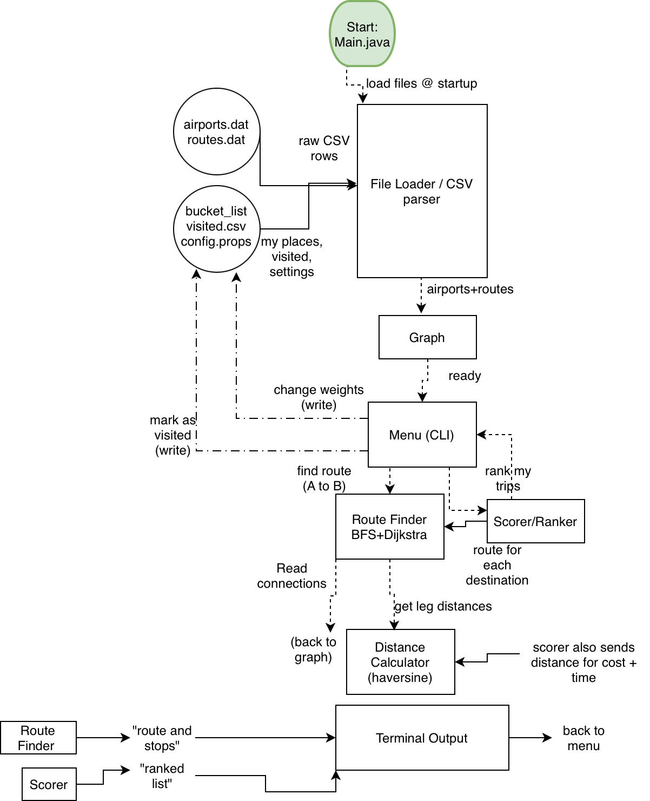

# Trip Decision Engine

A Java command-line tool that ranks my travel bucket list using airline
route data and scoring weights I can adjust.

## Project Goal

I have a long bucket list of places to visit (stadiums, Grand Slam venues,
new countries), but as a student with limited money and break time, I have
no good way to decide which trip to take next. This tool scores each
possible trip on cost, travel time, connections, and new countries gained,
and shows how the ranking changes when my priorities change.

## MVP Scope

- Load airports and routes from the OpenFlights dataset into a graph
- Calculate distances between airports (haversine formula)
- Find the fewest-connection route (BFS) and shortest-distance route (Dijkstra)
- Load my bucket list and visited list from CSV files
- Score and rank trips using adjustable weights
- Command-line menu: rank trips, look up a route, mark a place visited,
  change weights

## Future Plans (Schedule Quadrant)

- Multi-stop trip planner (nearest-neighbor + 2-opt ordering)
- Stats on countries and continents visited and total distance
- Map export of visited places
- Season dates for sporting events

## Tech Stack

- **Language:** Java 17
- **Libraries:** Java standard library only; JUnit 5 for tests (optional)
- **Data storage:** plain CSV and `.properties` files in `data/`
- **Data source:** [OpenFlights](https://openflights.org/data.html)
  airports and routes datasets (downloaded once, stored in the repo)

## System Diagram

## Eisenhower Matrix

[View the Eisenhower Matrix (PDF)](docs/eisenhower-matrix.pdf)

## Status

Planning phase complete. Build in progress.

## Credits

Airport and route data from [OpenFlights](https://openflights.org/data.html).
This is an educational project and gives no financial or travel advice.
Cost figures are estimates based on distance, not real fares.
